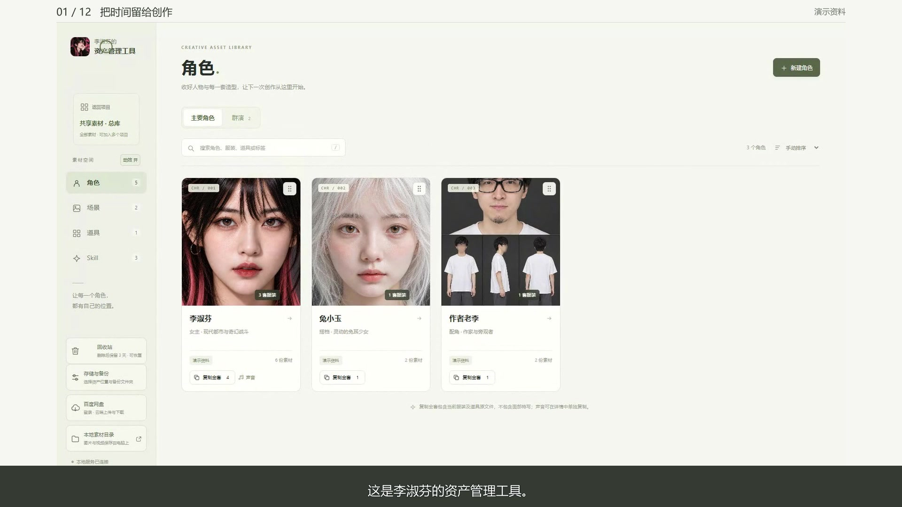

# Lishufen Asset Manager

[中文](README.md) | **English**

**A local asset library for AI creators. Organize by project, copy original files in one click, and send assets straight to a supported creative canvas.**

I built this tool for my own AI video workflow: keep characters, outfits, scenes, props, extras, voice references and Skills together, then find and reuse them without digging through folders.

Created by **AIGC异想天开的老李** · [Douyin](https://v.douyin.com/RnsvkrkP2rU/) · [Bilibili](https://space.bilibili.com/494755856)

## From your library to your creative canvas

### Copy the original file

Find a card and click its copy button, then paste into an app that accepts files using **Ctrl+V** on Windows or **Command+V** on Mac. You get the original file, preserving its quality. Character bundles include current outfit images and their associated props, saving you from finding each image separately.

### Send assets from a floating browser panel

The **Chrome / Edge extension** lets you select a project, browse characters and outfits, preview images and listen to voice references alongside your creative website. Click the send button to deliver the original files to the canvas or upload area at the **center of the visible page**.

**Open your creative page → open the asset panel → find an asset → send it → continue creating.**

The extension provides entry points for Jimeng, LibTV, Seko, Xiaoyunque and Updream. The website must accept file drops; check its own preview after sending. You can also copy the original file from the main app and paste it into a compatible destination. The extension does not click Generate.

### Reuse assets across projects

The shared library holds all your assets. Projects reference that library, so the same asset can belong to multiple projects and updates appear wherever it is used. Characters keep outfits, props and voice references together; Skills keep their instructions, examples and version history.

## Download

**[Download for Windows](https://github.com/wenjinli29-png/lishufen-asset-manager/releases/download/v19.4.0/Lishufen-Asset-Manager-Windows.zip)** · [Chrome / Edge extension 0.7.5](https://github.com/wenjinli29-png/lishufen-asset-manager/releases/download/v19.4.0/Lishufen-Asset-Manager-Browser-0.7.5.zip) · [Release notes](https://github.com/wenjinli29-png/lishufen-asset-manager/releases/tag/v19.4.0)

**v19.4.0: save your favorite styles and add assets more easily.** The main app now includes a Midjourney P value collection: find a style by its preview and copy the complete `--p` parameter. Add buttons sit beside search and stay available while scrolling. This release also restores the desktop mascot when it loses its position above other windows, and fixes missing character thumbnails after the extension background worker wakes. [What's changed](RELEASE_NOTES.md)

For **Windows 10 / 11, 64-bit**. Extract the complete ZIP, open **李淑芬的资产管理工具.exe**, create a project and add your assets. Keep the extracted files together.

### Mac preview

The Mac downloads remain at **v19.1.0-mac.1**. The v19.4.0 update above covers the Windows app and browser extension.

For **macOS 15 or later**. Choose the build matching your Mac:

- [Apple Silicon — M-series Macs](https://github.com/wenjinli29-png/lishufen-asset-manager/releases/download/v19.1.0-mac.1/Lishufen-Asset-Manager-macOS-AppleSilicon.zip)
- [Intel Macs](https://github.com/wenjinli29-png/lishufen-asset-manager/releases/download/v19.1.0-mac.1/Lishufen-Asset-Manager-macOS-Intel.zip)

Check **About This Mac** if you are unsure. Extract the complete package and open **李淑芬的资产管理工具.app**. Copying original files works with **Command+V** in Finder; other apps decide whether they accept file pastes.

The Mac preview is not Apple-notarized. If macOS blocks opening it, keep the message and share feedback; do not turn off system security settings.

Each download starts with an empty library. The characters shown in the demo are examples, and you can use your own assets. The current Windows app and extension offer Chinese and English; the included narrated video and illustrated guide are in Chinese.

## Watch the demo

[Watch the 3-minute demo](https://github.com/wenjinli29-png/lishufen-asset-manager/releases/download/v19.0.0/Lishufen-Asset-Manager-Demo.mp4) · [Illustrated guide](https://github.com/wenjinli29-png/lishufen-asset-manager/releases/download/v19.0.0/Lishufen-Asset-Manager-Guide.pdf)

The narration and guide are in Chinese and show Windows. Mac startup, shortcuts and storage notes are included in the Mac package.

## What you can organize

- **Projects:** reuse shared assets across multiple projects.
- **Characters:** face covers, outfits, props and voice references in one place.
- **Scenes, props and extras:** browse visual cards, folders and search results; copy multiple extras together.
- **Skills:** keep instructions, descriptions, examples and original packages with update history.
- **Midjourney P values:** save a code, preview image, name and notes in the main app; copy the complete `--p code` in one click. The collection is shared across projects and included in asset exports and backups.
- **Local files and backups:** keep your assets on your computer, create local backups, or upload and download your library using your own Baidu Netdisk account.

## Useful details

Add buttons now sit at the top left of the collection, beside search, and remain available while scrolling. Outfit and prop controls stay at the top left of their own sections inside a character.

Open **P value collection** in the main app, paste a code or `--p code`, and drop in a preview image. Copying returns the parameter text without the image. Use the updated app to import packages containing P values.

Character and outfit bundles include current outfit references and associated image props. Face covers, voice references and older versions are excluded; copy voices separately. Selecting multiple extras copies multiple files and does not automatically create a collage.

Removing an asset from a project keeps the shared original. Deleting an asset from the shared library affects projects referencing it, so the app asks before deletion. Deleted items can be restored from Trash for three days.

To install the extension, open your browser's extension management page, enable Developer mode, choose **Load unpacked**, and select the **浏览器插件** folder from the package. Keep the main app running while using it. After updating to 0.7.5, click **Reload** on the extensions page and refresh your creative website.

In the extension's character list, **Import all assets** includes current outfit images, matching props and the voice reference. Inside a character, **Import assets** includes only that outfit and its props. Both exclude the face cover and older versions. The extension accepts files up to 32 MiB each and 64 MiB per import batch. Failed previews show a reason and a **Retry preview** button.

Baidu Netdisk automatic sync is optional. When enabled, it checks on opening and syncs after changes, without repeated idle checks. Transfers currently cover the whole library, so larger libraries take longer.

Closing the web page leaves the app running. Wait for transfers to finish, then use **关闭后台服务.exe** on Windows or Quit from the Mac app. Back up your library before updating.

## Find me

I'm **AIGC异想天开的老李**. Try the tool, share your feedback, and join me to talk about AI video creation.

- [Douyin](https://v.douyin.com/RnsvkrkP2rU/)
- [Bilibili](https://space.bilibili.com/494755856)
