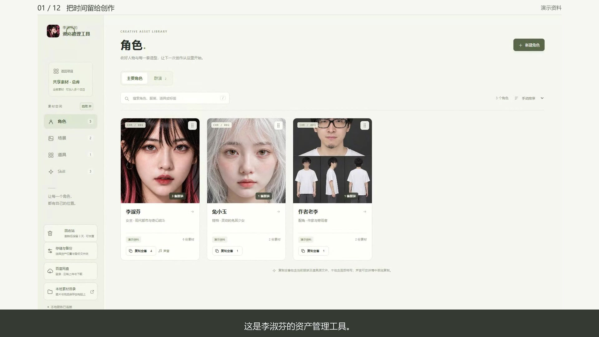

# 李淑芬的资产管理工具

作者：**AIGC异想天开的老李** · [抖音主页](https://v.douyin.com/RnsvkrkP2rU/) · [B站主页](https://space.bilibili.com/494755856)

这是我在做 AI 视频时，给自己做的一套素材管理工具。希望让找素材、复制素材这件事更省心。

角色、服装、场景、道具、声音和 Skill 都可以放在一起，按项目整理，需要时点一下就能复制原文件。

## 下载与使用

**[下载 Windows 版](https://github.com/wenjinli29-png/lishufen-asset-manager/releases/latest/download/Lishufen-Asset-Manager-Windows.zip)** · [查看更新](https://github.com/wenjinli29-png/lishufen-asset-manager/releases/latest)

适用于 Windows 10 / 11 64 位电脑。

1. 下载后右键选择“全部解压”，把整个文件夹放到自己方便的位置。
2. 双击“李淑芬的资产管理工具.exe”，在打开的页面中新建项目，拖入自己的素材。
3. 找到需要的卡片，预览后点“复制原文件”，再到创作软件里粘贴。

第一次打开是空素材库。演示里的角色只是例子，可以换成你自己的素材。完整说明、视频和图文指南都放在软件包里。

## 先看一段演示

[观看约 3 分 19 秒的中文讲解](https://github.com/wenjinli29-png/lishufen-asset-manager/releases/download/v19.0.0/Lishufen-Asset-Manager-Demo.mp4) · [查看六页图文指南](https://github.com/wenjinli29-png/lishufen-asset-manager/releases/download/v19.0.0/Lishufen-Asset-Manager-Guide.pdf)

## 可以做什么

- **按项目整理素材**：总库里存一份，同一素材可以加入多个项目，修改后一起更新。
- **管理角色与造型**：面部封面、声音参考、不同服装和道具放在同一张角色卡里，方便预览和取用。
- **快速找场景、道具和群演**：用卡片、文件夹和搜索整理图片，也可以多选群演复制。
- **收好用过的 Skill**：保存正文、说明、示例图和制作包，保留更新历史，随时比较或换回之前的版本。
- **在创作网页旁取用素材**：Chrome / Edge 插件可以查找、预览、试听和放入素材，悬浮入口可以拖动。
- **把资料留在自己手里**：素材存在自己的电脑，可另存本地备份，也可以登录自己的百度网盘上传或下载整个素材库。

## 几个使用小提示

“复制全套”和“复制本套”会带上当前服装图与对应道具，面部封面、声音和旧版本不在其中；声音可以单独复制。群演多选复制的是多个原文件，暂时不自动拼图。

从项目里移除素材，不会删除总库原件；删除总库素材会影响引用它的项目，操作前会弹窗提示。删除后可在回收站保留三天，期间可以恢复。

安装插件时，打开浏览器的扩展管理页，开启开发者模式，选择“加载已解压的扩展程序”，再选软件包里的“浏览器插件”文件夹。插件面向即梦、LibTV、Seko和小云雀；网页能否接收素材取决于对应上传区域，放入后看一下网站预览，再继续生成。

百度网盘的自动同步需要自己开启：打开时检查一次，修改后同步，空闲时不反复检查。当前上传和下载的是整个素材库，资料多时请耐心等传输完成。

关闭网页后软件仍在后台运行。需要完全退出时，等传输结束，再双击“关闭后台服务.exe”。更新软件前记得先备份自己的资料。

## 找到我

我是 **AIGC异想天开的老李**。欢迎大家试用，也欢迎来聊聊 AI 视频创作和使用建议。

- 抖音：[AIGC异想天开的老李](https://v.douyin.com/RnsvkrkP2rU/)
- B站：[AIGC异想天开的老李](https://space.bilibili.com/494755856)
